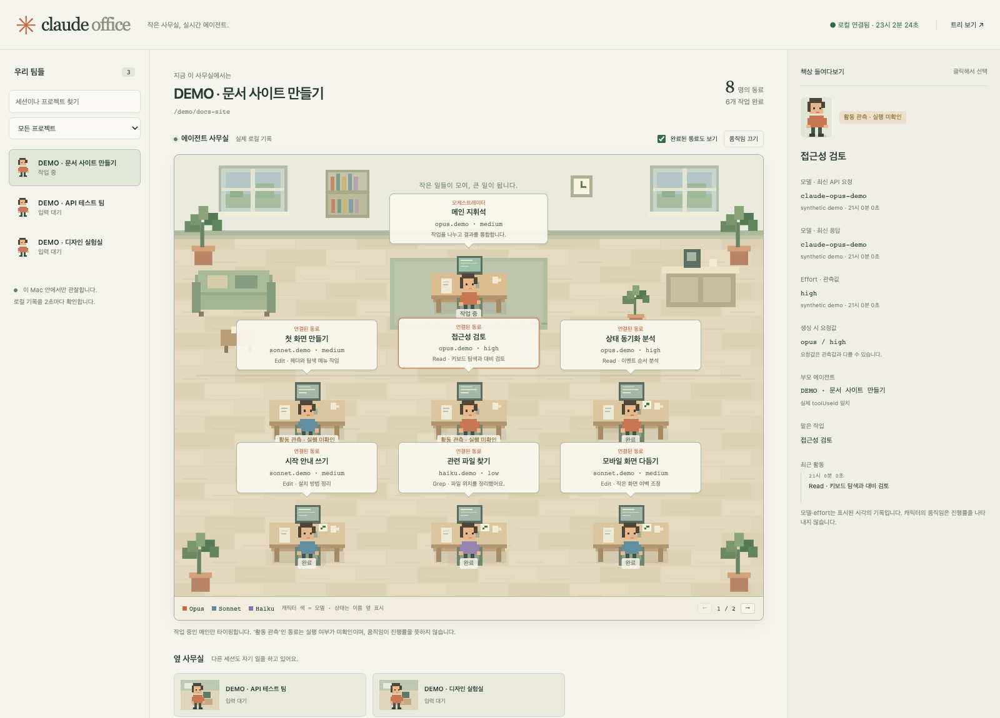

# han-project

**Claude Code에 역할별 AI 팀을 꾸리고, 픽셀 사무실에서 그 팀을 관찰하는 도구.**

Role-based Claude Code orchestration skills + a local, read-only pixel office visualizer.



> 위 이미지는 공개용 가상 데모입니다. 실제 사용자 대화·프로젝트·파일 경로를 포함하지 않습니다.

`/han-project`는 큰 작업을 탐색·구현·분석·검토 역할로 나눠, 각 작업에 모델과 effort를 명시하도록 돕는 **프롬프트 기반 작업 정책**입니다. 함께 제공되는 사무실은 로컬 Claude Code 기록을 읽어 세션, 하위 에이전트, 모델·effort와 최근 작업을 보여줍니다. 두 도구는 따로 사용할 수도 있습니다.

## 바로 체험하기

Python **3.10 이상**과 Git만 있으면 가상 사무실을 열 수 있습니다. 추가 Python 패키지·API 키가 필요 없고, 데모 실행은 Claude를 호출하지 않습니다.

```bash
git clone https://github.com/maltayse/han-project.git
cd han-project
python3 visualizer/observer.py --demo --open
```

터미널에 표시되는 주소를 열면 됩니다. 기본 주소는 `http://127.0.0.1:8765`이며, 이미 사용 중이면 빈 포트를 선택합니다. 종료는 **Ctrl-C**.

## 내 Claude Code에서 사용하기

### 1. 스킬과 에이전트 설치

먼저 어떤 파일을 설치하는지 확인하고 설치합니다.

```bash
python3 install.py --dry-run
python3 install.py
```

설치 대상은 `~/.claude/skills/han-project/`, `~/.claude/skills/han-handoff/`, `~/.claude/agents/han-*.md`의 **7개 파일**입니다. 인증정보, `settings.json`, 권한 모드, 모델 기본 설정을 변경하지 않습니다. 다른 내용의 파일이 이미 있으면 아무것도 설치하지 않고 중단합니다. 검토 후 `--force`를 쓰면 다른 파일을 백업하고 교체합니다.

특정 프로젝트에만 설치하려면:

```bash
python3 install.py --claude-dir /path/to/your-project/.claude
```

새 Claude Code 세션을 열거나 `/agents`에서 에이전트를 다시 불러온 뒤, `/han-project`와 `han-*` 역할을 확인하세요. 스킬은 [Claude Code의 사용자/프로젝트 스킬 경로](https://code.claude.com/docs/en/skills)에, 에이전트는 [사용자/프로젝트 에이전트 경로](https://code.claude.com/docs/en/sub-agents)에 설치됩니다.

### 2. 작업 지시

원본 스킬은 부모 세션에 **Fable / medium**을 권장합니다. 부모 모델은 스킬이 바꾸지 않습니다. 사용 가능한 모델과 effort를 먼저 확인하고 직접 선택하세요.

```text
/model fable
/effort medium
/han-project 문서 사이트에 검색 기능을 추가해줘. 기존 변경을 보존하고, 테스트와 독립 검토 결과까지 정리해줘.
```

**Fable을 사용할 수 없는 계정/제공자**라면 부모 모델은 `/model`에서 지원되는 것으로 직접 선택하세요. `agents/han-advisor.md`의 `model: fable`과 스킬의 advisor 라우팅도 사용 가능한 모델로 일관되게 바꾼 뒤 설치하세요. 제한·인증 오류를 우회하기 위해 모델을 바꾸는 용도로 사용하지 마세요. 이 저장소는 모델 접근권이나 별도 Claude Code 요금제를 제공하지 않습니다.

작업을 이어갈 문서가 필요하면:

```text
/han-handoff docs/agent-work/my-task/handoff.md
```

### 3. 실제 세션을 사무실에서 보기

다른 터미널에서:

```bash
python3 visualizer/observer.py --open
```

macOS에서는 `visualizer/launch.command`를 더블클릭해도 됩니다. 기본으로 `~/.claude`를 읽으며 다른 경로는 `--claude-dir`로 지정합니다.

```bash
python3 visualizer/observer.py --claude-dir /path/to/.claude --port 8766 --open
```

## 팀 구성

| 역할 | 모델 별칭 / effort | 맡기는 일 |
|---|---|---|
| 부모 오케스트레이터 | 권장 Fable / medium, 수동 선택 | 의존성·파일 소유권·작업 배정·통합 |
| `han-scout` | Haiku / low | 정확한 읽기 전용 탐색과 로그 요약 |
| `han-builder` | Sonnet / medium | 범위가 정해진 구현과 테스트 |
| `han-deep` | Opus / high | 복잡한 디버깅, 여러 모듈에 걸친 변경 |
| `han-reviewer` | Opus / high | 독립적인 읽기 전용 정확성·보안 검토 |
| `han-advisor` | Fable / high | 풀리지 않은 큰 설계 결정에 한 번 자문 |

동시에 최대 3명의 worker를 요청하고, 같은 파일 수정은 직렬로 처리합니다. 실제 가능한 도구·모델을 확인하고, 모델·effort를 명시해 배정하며, 실패 근거에 따라 재계획합니다. worker는 작업 결과·검증·미확인 사항·근거 위치를 짧게 반환합니다. 부모는 결과를 직접 확인하고 순서대로 통합합니다.

이는 강제 실행 엔진이나 비용 제한기가 아닙니다. Claude Code가 지침을 따르도록 돕는 정책이며, 모든 모델 호출은 각자의 계정 사용량에 반영됩니다. 성능·비용 절감률은 별도 측정하지 않았습니다. Superpowers 등을 이미 사용한다면 기존 개발 절차를 유지하면서 역할 배정 정책을 보완하는 용도로 쓸 수 있으며, 설치기가 별도 플러그인을 설치하지는 않습니다.

## 사무실에서 읽을 수 있는 것

- **가운데 지휘석:** 선택한 메인 세션. 작업 중으로 기록된 메인만 타이핑합니다.
- **주변 책상:** 그 세션의 하위 에이전트. 모델별 색은 Opus 주황, Sonnet 파랑, Haiku 보라입니다. 최근 미완료 기록을 먼저 보여주고, 6개씩 페이지를 넘깁니다.
- **책상 말풍선:** 작업 이름, 관측 모델·effort. 관측값이 없으면 요청값 또는 미확인으로 표시합니다.
- **오른쪽 상세:** API 요청 모델, 응답 모델, 관측 effort, 생성 요청값과 각각의 출처·시각.
- **옆 사무실:** 같은 컴퓨터의 다른 세션. 별도 세션을 부모·자식으로 추측해 연결하지 않습니다.
- **트리 보기:** `/classic`에서 목록과 에이전트 관계를 확인합니다.

‘활동 관측’은 **현재 실행 중이라는 뜻이 아닙니다.** 완료 기록이나 레지스트리 상태 외에는 확정할 수 없는 정보를 추정하지 않습니다. 움직임은 진행률을 나타내지 않습니다. 실제 `toolUseId`가 일치할 때만 부모를 연결하고, 확인되지 않으면 부모 미확인으로 남깁니다. OS의 동작 줄이기 설정과 움직임 끄기 버튼을 지원합니다.

## 호환성과 개인정보

- 실제 세션 수집은 **macOS의 Claude Code 2.1.322 / 2.1.325**에서 확인했습니다. Python 테스트는 CI에서 macOS/Linux를 확인합니다. 가상 데모는 Claude Code 없이 동작합니다. Windows의 실제 세션 수집은 지원하지 않습니다.
- 실제 수집은 `~/.claude/sessions/*.json`과 대응하는 프로젝트 transcript·에이전트 메타데이터를 읽습니다. 내부 형식은 안정된 공개 API가 아니므로 Claude Code 버전에 따라 세션이나 필드가 누락될 수 있습니다.
- 처음에는 스트리밍으로 읽고 이후 로그 증가분을 수집합니다. 원본 기록을 수정하지 않으며 hooks를 설치하지 않습니다. 레지스트리에 없는 실행은 표시되지 않습니다.
- 서버는 `127.0.0.1`에만 열고 Host/Origin을 검사합니다. 인증 키 파일, 전체 API 본문, 도구 출력은 화면 API에 싣지 않습니다. **작업명·최근 메시지·경로 일부는 실제 대화에서 온 정보**이므로 화면을 공개할 때 주의하세요. 같은 계정의 다른 로컬 프로그램으로부터 격리하지는 않습니다.
- 공개용 화면을 찍을 때는 **`--demo`**를 사용하세요. 데모 모델 이름의 `-demo`는 실제 API 모델 ID가 아닙니다.

## 검증하기

```bash
python3 -m unittest discover -s tests -v
cd visualizer
python3 -m unittest discover -s tests -v
```

설치 충돌·백업·심볼릭 링크, 증분 로그와 불완전 행, PID 재사용, 부모 연결, 모델/effort 구분, HTTP 접근 제한, 데모의 파일 미접근을 테스트합니다. 이 검증은 Claude가 실제 작업에서 지침을 따르거나 모델 호출에 성공함을 보장하지 않습니다. 자세한 한계는 [설계와 검증](docs/ARCHITECTURE.md)을 참고하세요.

## 파일 구성

```text
skills/          han-project, han-handoff 원본 스킬
agents/          역할별 에이전트 5종
visualizer/      Python 서버, 수집기, 픽셀 사무실, 가상 데모
install.py       기존 설정을 보존하는 설치기
tests/           설치기 테스트
```

MIT License. 스킬 원본과 시각화는 이 저장소에 함께 제공됩니다. 픽셀 아트는 코드로 직접 그리며 외부 이미지 에셋을 포함하지 않습니다. 캐릭터 사무실이라는 표현 방식은 Pixel Agents 계열에서 영감을 받았습니다. Claude Code는 Anthropic의 제품이며, 이 프로젝트는 독립적인 커뮤니티 도구입니다.
