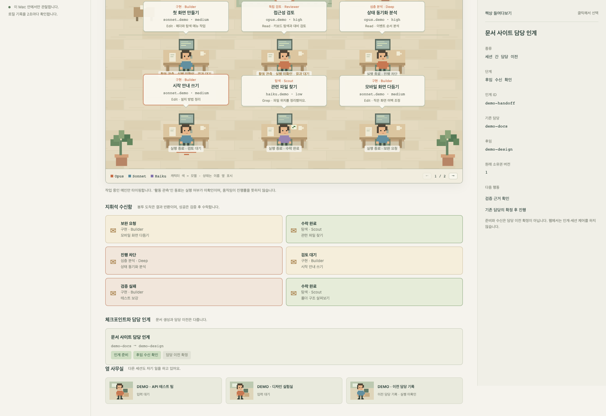

# 모델·역할·인계 QA

검증 환경: Claude Code 2.1.322, macOS. 구현 기준은 `91a16f6`에서 시작한 verified-handoff 변경입니다. 합성 Git 저장소와 별도 로컬 상태를 사용했으며 실제 프로젝트 대화·계정 ID·경로·원문 transcript는 공개하지 않습니다.

## 실제 모델 호출

| 역할 | 요청 모델 / effort | 응답에서 관측한 모델 | 확인한 행동 |
|---|---|---|---|
| Scout | haiku / low | claude-haiku-5-5 | Read만 사용; 추론과 실제 테스트 결과 구분 |
| Builder | sonnet / medium | claude-sonnet-5-5 | 지정 파일만 수정, unittest 1개 실제 통과 |
| Deep | opus / high | claude-opus-5-5 | 분석 전용 범위 준수 |
| Reviewer | opus / high | claude-opus-5-5 | 수정·테스트 실행 요청을 거절하고 코디네이터에게 실행 요청 |
| Advisor | fable / high | claude-fable-5-2 | 제한된 설계 자문, 수정·실행 없음 |

위 5회는 baseline 역할 본문을 명시적인 `--agents`로 공급한 native `--agent` 실행입니다. 설치된 `/han-project` 전체 실행과는 구분합니다. 추가 라우팅 호출에서는 Fable/medium 부모가 실제 비-fork Agent를 Scout haiku/low, Reviewer opus/high로 순차 호출했고, 각각의 응답 모델도 별도로 관측했습니다.

**실효 effort는 응답 스트림에서 관측되지 않아 미검증입니다.** 요청 파라미터가 explicit이라는 사실을 실효 effort의 증명으로 사용하지 않습니다. 역할을 한 번 수행한 결과가 모든 프로젝트에서 지침을 준수함을 보장하지도 않습니다.

각 호출에는 $1 실행 예산 상한을 두었으며 인증·권한·billing 설정을 바꾸거나 bypass 플래그를 쓰지 않았습니다. 첫 MCP 빈 설정 오류는 모델 호출 전에 실패했고 같은 모델로 설정 구문만 바로잡았습니다. 성공한 baseline 역할/라우팅 호출 6회의 CLI 환산 보고값 합계는 약 $0.6034였습니다. 실제 청구액 또는 일반적인 작업 비용의 측정이 아닙니다.

## 자동 검증

다음 명령으로 설치기/런타임/역할 계약/시각화를 검사합니다.

```bash
python3 -m unittest discover -s tests -v
cd visualizer
python3 -m unittest discover -s tests -v
```

검사 범위: 설치 충돌·백업 경로·독립 설치된 런타임, 역할 기본값/도구 권한, 결과와 수락 분리, 독립 검토/근거·Git 변경 차단, 인계 준비/수신/확정, 중복/경합/작업 중 Worker 차단, 상태 재시작, 이전 담당 보존, private note/과거 실패 근거 보존, 문서 실패 롤백, dirty submodule 거부, HTTP 접근 제한, 합성 데모의 파일 미접근.

런타임 검토에서 준비 후 결과가 바뀌는 경우, 과거 실패 로그 재사용, 혼합 시점의 status 읽기, dirty submodule의 누락을 발견했습니다. 새 테스트로 실패를 재현하고 snapshot/근거 사본/읽기 트랜잭션/명시적 거부로 수정했습니다.

## 화면 검증

합성 데모에서 역할 배지, 실패 봉투, 수신 상태와 확정 상태, 이전 담당 기록을 확인했습니다. 새로고침 후 선택한 봉투 상세 유지, 390px에서 문서 가로 넘침 없음, 브라우저 오류 없음도 확인합니다. 웹은 읽기 전용이며 실제 인수 명령을 전송하지 않습니다.

## 해석의 한계

- 계정/제공자 전체의 모델 접근성·fallback, 장기 실패율·비용 절감·모든 지침 준수율은 평가하지 않았습니다.
- 코디네이터가 기록하는 결과와 검토는 명시적 attestation입니다. 로컬 세션 ID 문자열은 인증 수단이 아니며 도구를 거치지 않은 수정까지 차단하지 않습니다.
- 실제 인계 스킬 검증은 아래 별도로 기록합니다. 테스트를 추가했다는 이유만으로 실제 모델 실행도 통과했다고 간주하지 않습니다.

## 실제 설치된 인계 스킬 호출

별도 합성 Git 저장소에 새 스킬 3종·역할 5종·런타임을 실제 설치하고, project 스킬만 로드해 같은 이름의 전역 스킬 충돌을 배제했습니다. Fable/medium에서 다음 상태를 확인했습니다.

| 호출 | DB 단계 | 담당 / 버전 | 판정 |
|---|---|---|---|
| 사용자 호출 `/han-handoff` | prepared | 기존 담당 / 1 | 문서·체크포인트 생성, 담당 유지 |
| 사용자 호출 `/han-resume` | prepared 유지 | 기존 담당 / 1 | QA 명령 allowlist의 경로 별칭 문제로 안전하게 중단 |
| 같은 허용 경로의 정규/별칭을 맞춘 `/han-resume` | received | 기존 담당 / 1 | 수신만 기록하고 작업 대기 |
| 실제 기존 담당 세션 ID로 명시적 CLI 확정 요청 | committed | 후임 / 2 | 재검증 후 담당 변경 |

후임 UUID를 프롬프트에 넣지 않았는데도 실제 CLI `--session-id`와 같은 값이 수신 명령에 사용되어 `${CLAUDE_SESSION_ID}` 확장을 확인했습니다. `${CLAUDE_SKILL_DIR}` 기반 설치 런타임 경로도 확인했습니다. 관련 없는 Worker 생성/메시지 전송/프로젝트 수정은 관측되지 않았습니다.

좁은 QA allowlist가 복합 Bash 명령과 경로 별칭을 거절한 횟수는 호출별 2/4/2/1건입니다. 실패를 숨기거나 권한 모드를 바꾸지 않았고, 동일하게 승인된 런타임의 경로 표기만 바로잡아 재시도했습니다. source 확정은 별도 commit 스킬이 아니라 사용자 명시 요청으로 실행했습니다.

이 4회는 실제 세션 UUID를 지정한 stateless 호출입니다. native `--resume`의 대화 유지까지 검증한 것은 아닙니다. Worker가 없는 happy path였으며 변경된 증거·활성 Worker·동시 인수는 모델 호출 대신 결정적 자동 테스트로 검증했습니다. 추가 호출의 환산 보고값 합계는 약 $1.0802이며 실제 청구액이 아닙니다. 실효 effort는 계속 미확인입니다.



## 실제 새 `/han-project` 스모크

새 설치본을 별도 합성 저장소에서 사용자 명령으로 호출했습니다. Fable/medium 부모가 Scout haiku/low를 비-fork Agent로 정확히 한 번 실행했고, 응답에서는 Fable5.2와 Haiku5.5를 관측했습니다. 반환된 실제 native agent ID와 runtime 등록 ID가 일치했습니다.

코디네이터는 배정 전 소스/요구사항을 Read하고 반환 후 content Grep로 근거를 확인했습니다. 새 task/attempt는 각각 하나이며, 결과는 ended/ready, 독립 검토는 없음으로 남겼고 테스트·수락을 주장하지 않았습니다. 전 단계에서 이전에 인계한 task는 변경하지 않았습니다.

QA allowlist가 편의용 명령 2건을 거부했고, `show <task-id>` 및 `status <task-id>` 구문 오류를 bare status로 복구했습니다. 실패를 숨기지 않습니다. 이 호출은 작은 읽기 전용 과제의 스모크이며 복잡한 프로젝트의 전체 지침 준수율 검증이 아닙니다. 실효 effort는 여전히 미확인입니다. 이 호출까지 포함한 새 스킬 QA 5회의 환산 보고값 합계는 약 $1.7068입니다.
